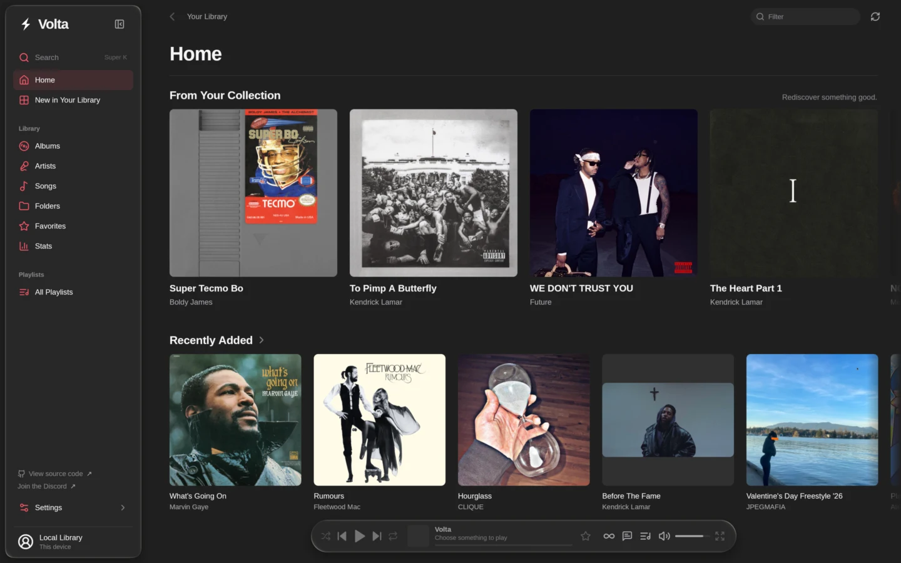
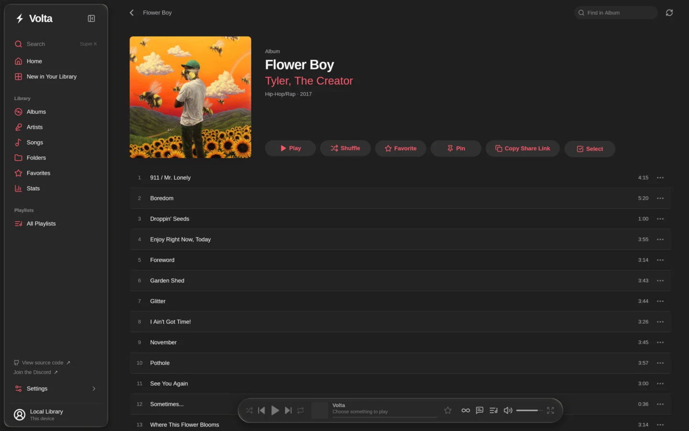
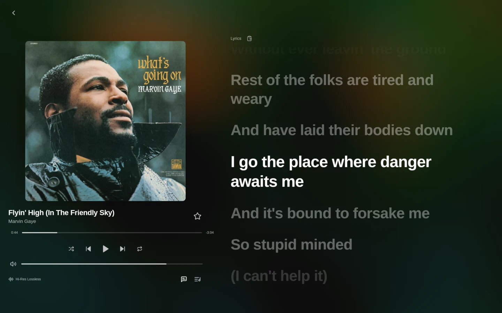

<div align="center">


# Volta Desktop

**A native desktop music player for Navidrome and local music. Rust and gpui, no Electron or webview.**


</div>

---

<table>
  <tr>
    <td align="center"><br><sub><b>Home</b> · shelves from your library</sub></td>
    <td align="center"><br><sub><b>Album</b> · track list and actions</sub></td>
  </tr>
  <tr>
    <td align="center" colspan="2"><br><sub><b>Full player</b> · artwork-tinted background</sub></td>
  </tr>
</table>

Volta Desktop is a native port of [Volta Player](https://player.voltamusic.xyz), the web app. It's one binary that draws its own window and plays its own audio: symphonia decodes, cpal outputs, and OS media keys work through MPRIS / SMTC.

## Features

- **Playback** Gapless and crossfade, AutoMix, ReplayGain, shuffle/repeat, and an infinite autoplay queue.
- **Library** Home shelves and recommendations, albums, artists, songs, folders, playlists, favorites, search, and listening stats.
- **Lyrics** Time-synced lyrics (via [LRCLIB](https://lrclib.net)) with a full-screen player.
- **Sources** A Navidrome / Subsonic server, or a folder of local files.
- **Themes** Dark, light, high-contrast, or follow the system.

## Build

You need a recent Rust toolchain (edition 2024) and, on Linux, the usual Wayland/X11, Vulkan, and ALSA development packages.

```bash
cargo run --release -p volta     # run the app
cargo test --workspace           # tests
```

Also check out [Volta iOS](https://github.com/countervolts/Volta) and the web player at <https://player.voltamusic.xyz>.
